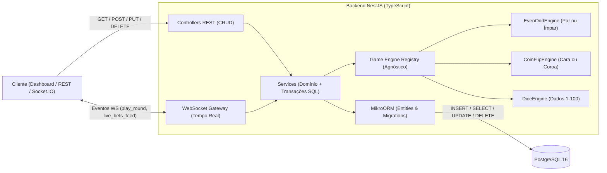

# 🌴 Jungle Gaming — Agnostic iGaming Platform (NestJS + MikroORM + PostgreSQL + WebSockets)

Plataforma backend de **iGaming** construída com **NestJS (TypeScript)**, **MikroORM**, **PostgreSQL**, **REST API (CRUD Completo)** e **WebSockets em Tempo Real (Socket.IO)**.

O sistema começa implementando o jogo **Par ou Ímpar (`even-odd`)**, mas possui arquitetura **100% agnóstica** baseada nos padrões **Strategy + Registry** e colunas `JSONB` no PostgreSQL — permitindo plugar novos jogos (como **Cara ou Coroa (`coin-flip`)** e **Dados 1–100 (`dice`)**, já inclusos) sem alterar nenhuma tabela SQL, Controller REST ou Gateway WebSocket.

---

## 🏗️ Arquitetura do Sistema



---

## 🔄 Mapeamento CRUD (API REST ↔ MikroORM ↔ SQL no PostgreSQL)

| Operação | Método HTTP | Rota REST | Método MikroORM | SQL Gerado no PostgreSQL |
| :--- | :--- | :--- | :--- | :--- |
| **Create** | `POST` | `/players`, `/games` | `em.create()` + `em.persistAndFlush()` | `INSERT INTO "players" ...` |
| **Read** | `GET` | `/players`, `/players/:id`, `/games` | `em.find()` / `em.findOne()` | `SELECT * FROM "players" ...` |
| **Update** | `PUT` | `/players/:id`, `/games/:id` | `wrap(entity).assign()` + `em.flush()` | `UPDATE "players" SET ... WHERE "id" = ...` |
| **Delete** | `DELETE` | `/players/:id`, `/games/:id`, `/games/rounds/:id` | `em.removeAndFlush()` | `DELETE FROM "players" WHERE "id" = ...` |

---

## 🧩 Como funciona o Motor Agnóstico de Jogos?

1. **Contrato Universal (`IGameEngine`):**
   Qualquer jogo implementa `validateInput(input, config)` e `executeRound(input, config)` em `src/games/engines/game-engine.interface.ts`.
2. **Catálogo em Memória (`GameEngineRegistry`):**
   Seleciona dinamicamente o motor pelo `slug` do jogo (`even-odd`, `coin-flip`, `dice`) sem `if/else` acoplado no serviço.
3. **Persistência Agnóstica (`JSONB`):**
   A tabela `game_rounds` armazena `input_payload` e `result_payload` como `JSONB` no PostgreSQL, além de um hash SHA-256 (*Provably Fair*) gerado com `crypto`.
4. **Transação Atômica (`em.transactional`):**
   Verificação de saldo, dedução da aposta, cálculo do prêmio, atualização da carteira (`players.balance`) e gravação da partida (`game_rounds`) ocorrem dentro de uma única transação SQL (`BEGIN ... COMMIT / ROLLBACK`).

---

## ⚡ Eventos WebSocket (Socket.IO)

- `join_game`: Conecta o jogador à sala de tempo real do jogo (`room:even-odd`, `room:coin-flip`, `room:dice`).
- `play_round`: Executa uma rodada em tempo real e emite:
  - `round_result`: Resultado detalhado da partida + Hash SHA-256 *Provably Fair*.
  - `wallet_updated`: Atualização instantânea do saldo da carteira.
  - `live_bets_feed`: Broadcast em tempo real para todos os clientes conectados.

---

## 🚀 Como Executar

### 1. Modo Desenvolvimento Zero-Config (PostgreSQL 16 Embutido)
Por padrão (`USE_EMBEDDED_POSTGRES=true` no `.env.example`), o servidor sobe automaticamente uma instância embutida do PostgreSQL 16 na porta `5433` e cria/popula as tabelas iniciais:
```bash
npm install
cp .env.example .env
npm run start:dev
```
Acesse o painel interativo em: **`http://localhost:3333`**

### 2. Usando Docker Compose (PostgreSQL Containerizado)
```bash
docker compose up -d
# No arquivo .env, defina USE_EMBEDDED_POSTGRES=false e DB_PORT=5432
npm run start:dev
```
